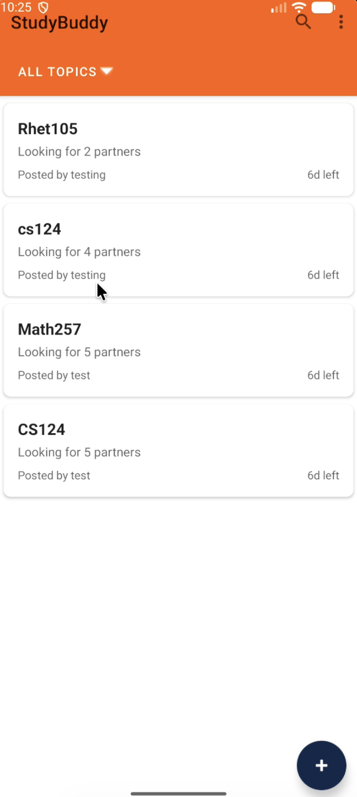

# StudyBuddy

A study-session bulletin board for college students, built as a native Android app.

Finding people to study with usually means posting in a group chat and hoping someone sees it. StudyBuddy gives students one shared board: post an open study session with the topic and how many partners you want, browse everyone else's sessions, and tap a post to get the poster's contact info and reach out directly. Posts expire after one week, so the board stays current.

## Key features

- **Email sign up and log in** with Firebase Authentication, including password reset
- **Profiles** with name plus optional email, phone and Discord contact fields
- **Create a post** with topic, ideal number of study partners and optional notes
- **Live feed** of active posts, newest first, with pull to refresh, topic filtering and keyword search
- **Post detail** view that shows the poster's contact info
- **My Posts** screen to review and delete your own posts
- **Auto-expiry**: posts older than 7 days are hidden from the feed, with a countdown on each card
- Loading, empty and error states on the feed and My Posts screens

## Tech stack


- Java 11, Android SDK 35 (min SDK 24)
- AndroidX AppCompat, Material Components, ConstraintLayout, RecyclerView, SwipeRefreshLayout
- Firebase Authentication and Cloud Firestore
- JUnit 4 unit tests

## How it works

```
MainActivity (welcome)
 ├── SignupActivity ──► ProfileSetupActivity ──► HomeActivity
 └── LoginActivity ─────────────────────────────► HomeActivity
HomeActivity (feed + topic filter)
 ├── CreatePostActivity
 ├── PostDetailActivity
 ├── MyPostsActivity
 └── ProfileSetupActivity (edit profile)
```

- **Auth:** Firebase Authentication handles accounts, sessions and password resets.
- **Data:** Cloud Firestore holds two collections. `users` stores each profile, keyed by the user's auth ID. `posts` stores topic, partner count, notes, poster ID and a `createdAt` timestamp.
- **Feed:** `HomeActivity` listens to `posts` in real time, querying only posts created in the last 7 days, ordered newest first. Topic filtering and keyword search run client side through a pure `filterPosts` method, which the unit tests cover.
- **Expiry:** the feed and My Posts queries only return posts from the last 7 days, and `PostAdapter` shows the time left on each card, so expired posts drop out without a server job.

## Getting started

### Prerequisites

- Android Studio (Ladybug or newer) with Android SDK 35
- A free Firebase project

### Setup

1. Clone the repo:
   ```bash
   git clone https://github.com/liam9107/StudyBuddy.git
   ```
2. In the [Firebase console](https://console.firebase.google.com/), create a project and add an Android app with the package name `edu.illinois.cs.cs124.ay2026.project`.
3. Enable **Email/Password** sign-in under Authentication, and create a **Cloud Firestore** database.
4. Download `google-services.json` and place it in the `app/` folder. It's gitignored, so it stays on your machine.
5. Open the project in Android Studio, let Gradle sync, then run the `app` configuration on an emulator or device.

### Run the tests

From Android Studio, right-click `app/src/test` and choose **Run Tests**, or run `gradle test` from the project root.

## Screenshots

| Welcome | Feed | Post detail | Create post |
|---|---|---|---|
| _screenshot_ | _screenshot_ | _screenshot_ | _screenshot_ |

<!-- Add images to docs/screenshots/ and replace the placeholders, e.g.  -->

## Roadmap

- Push notifications with Firebase Cloud Messaging
- Bookmarks for posts you're interested in
- Mark a post as full instead of deleting it

## About

Built by Liam Patel as an independent project for CS 124 at the University of Illinois Urbana-Champaign, Spring 2026.
